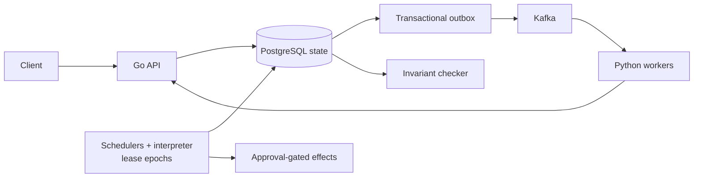
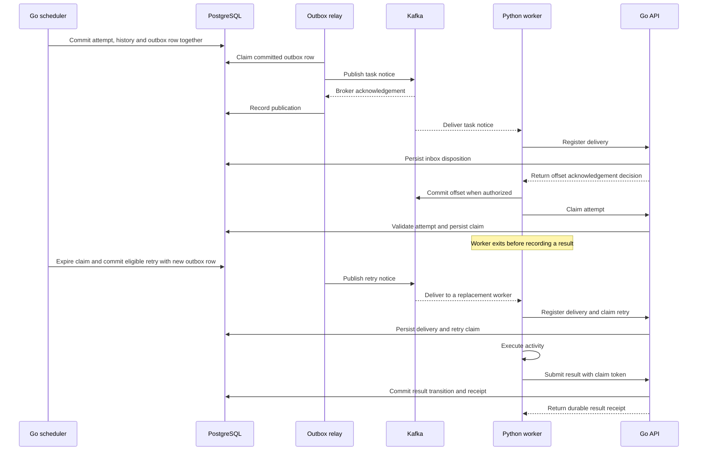

# Workflow engine design

## Problem

A scheduler can lose ownership while still running. A worker can finish an
activity and die before reporting the result. A message can be delivered again
after a consumer restarts. The engine preserves committed workflow progress
across these failures and gives operators a way to resolve uncertain external
actions. It exposes workflow state, attempts, approvals and receipts so recovery
can be checked from durable records.

## Architecture

The Go API validates submissions and the scheduler advances versioned workflow
graphs. PostgreSQL owns the workflow, its history and which attempt may commit.
Kafka carries task notices. Workers claim work through the API before executing
it and report outcomes back through that same boundary. The opt-in load-test
namespace sets limits on active workflows and pending outbox records. New
work above either configured limit gets HTTP `429` with `Retry-After`. [API error mapping](internal/api/server.go)
· [Admission guard](internal/state/admission.go) · [API test](internal/api/server_test.go).

### Recovery after a worker exits before recording a result

If the relay stops after publication but before updating the outbox, it can
publish the same notice again. Kafka offsets are acknowledged after durable delivery disposition. If the
worker stops before the result commits, the database still tracks the
attempt and can make eligible work claimable again.
An uncertain external effect takes the reconciliation path. The local Compose
pilot preserves normal and worker-kill traces for pure activity execution.
[Outbox relay](internal/transport/transport.go) ·
[Worker receipt and offset handling](python/workers/kafka_worker.py) ·
[HTTP-to-worker pilot](experiments/m8/dur042-pilot/).

## Design decisions

| Decision | Alternatives and trade-off | Evidence |
| --- | --- | --- |
| **PostgreSQL is the single authority.** Workflow state, history, ownership, claims and the outbox share a transaction boundary. | A broker-led state machine or independent stores for state and dispatch introduce additional coordination. The shared database makes commits inspectable and concentrates availability and contention in PostgreSQL. | [Durable state schema](migrations/000002_durable_state.up.sql) · [Transport schema](migrations/000006_m3_transport.up.sql) |
| **Fence writes with lease epochs.** The current epoch, workflow revision and attempt identity constrain writes. | Expiry alone permits a paused owner to wake up and write after takeover. A transaction-level fence adds database coordination and requires bounded lock waits. | [Preserved-process network isolation](experiments/portfolio/cloud-recovery/dur049-aws-20260923-full-0adbac0/network-isolation.json) · [Failure case study](experiments/portfolio/recruiter/failure-case-study.md) |
| **Commit a transactional outbox and retain Kafka.** | Publishing directly from the state transaction creates a dual-write gap. PostgreSQL polling and notification-driven direct dispatch can use the same outbox. Direct notification had lower resolved terminal latency than Kafka in the single-host Docker Desktop/WSL2 pure-activity study, with three repeats per configuration and 24 measured workflows per repeat. Ready-to-claim latency was unresolved. Kafka retains task notices for consumers that fall behind, at the cost of running a broker. The retention benefit after a consumer outage remains unmeasured. | [Matched dispatch comparison](experiments/m7/dur035/results.json) |
| **Use at-least-once delivery with idempotency and reconciliation.** | Broker-level exactly-once processing cannot atomically include an arbitrary external API. Stable claim, receipt and effect identities limit duplicate application at cooperating boundaries. Ambiguous effects need durable reconciliation and may pause progress. | [Worker tests](tests/test_kafka_worker.py) · [Effect and approval schema](migrations/000010_m4_recovery_effects_approvals.up.sql) |
| **Interpret declarative graphs with pinned versions.** | Deterministic code replay lets authors express workflows in a general-purpose language. A graph interpreter makes the allowed transitions explicit and persists the state needed for recovery. Authors work within the interpreter's node types and retain compatible activity implementations. | [Graph persistence](internal/state/graph.go) · [Versioned workflow schema](migrations/000002_durable_state.up.sql) |
| **Bind approval to the exact proposed effect.** | A coarse approval flag leaves room for a changed resource, changed arguments or a later workflow revision to inherit permission. The grant binds the approved identity and canonical arguments, adding validation, persistence and an audit trail. | [Grant binding schema](migrations/000013_m4_effect_grant_binding.up.sql) · [PostgreSQL integration tests](internal/incident/production_integration_test.go) |
| **Check durable evidence independently and test the checks with mutations.** | Reusing production validation as the oracle can reproduce its mistakes. A separate checker and a small reference model add maintenance and require complete evidence. Selected mutations establish whether the gate detects specific broken guards. | [Invariant checker](internal/invariants/checker.go) · [Reference model](internal/reference/model.go) · [Mutation manifest](mutations/manifest.json) |

## Build versus buy

This project keeps the transaction, transport and checker visible for controlled
failure studies. The operating and migration implications below follow from the
documented execution models.

| Platform | Replay and versioning | Effect semantics | Operating burden and lock-in | Sources |
| --- | --- | --- | --- | --- |
| This engine | Advances persisted graph state with a pinned definition and activity versions. | At-least-once dispatch, durable claims and receipts, approval-bound effects and reconciliation for unknown outcomes. | Operate the API, schedulers, workers, PostgreSQL and Kafka. Migration requires translating the graph, state and effect contracts. | [Engine](internal/engine/engine.go) · [Worker](python/workers/kafka_worker.py) |
| Temporal | Deterministically replays workflow code from event history. Worker Deployment Versioning can pin executions to a worker version. | Completed activity results are reused in replay. An activity with an unrecorded completion can retry, so external effects need idempotency. | Use Temporal Cloud or operate a Temporal Service. In both cases deploy workers and maintain Temporal SDK and replay compatibility. | [Workflows](https://docs.temporal.io/workflows) · [Worker versioning](https://docs.temporal.io/best-practices/worker) · [Activities](https://docs.temporal.io/activity-definition) |
| DBOS | Re-enters workflow code and reuses recorded step results. Recovery selects an executor running the workflow's application version. | Unfinished steps may retry. DBOS transactions have exactly-once commit semantics within the database boundary. External calls in retried steps need application-level idempotency. | Operate the application and its system database. Conductor coordinates distributed recovery. Migration requires adapting SDK annotations and system state. | [Workflow semantics](https://docs.dbos.dev/python/tutorials/workflow-tutorial) · [Recovery](https://docs.dbos.dev/production/workflow-recovery) |
| Restate | Replays a durable invocation journal. In-flight invocations are pinned to their registered service deployment. | Journaled results and SDK calls are reused. An external action inside an unfinished durable step can repeat. | Run the Restate server or use Restate Cloud and deploy service handlers. The SDK, invocation journal and deployment registration are migration boundaries. | [Journal semantics](https://restate.dev/blog/every-system-is-a-log-avoiding-coordination-in-distributed-applications) · [Versioning](https://docs.restate.dev/services/versioning) · [Hosting options](https://restate.dev/pricing) |
| AWS Step Functions | Interprets Amazon States Language. Published versions are immutable snapshots and aliases route new starts. | AWS documents exactly-once Standard workflow execution, at-least-once asynchronous Express and at-most-once synchronous Express. Configured retries and external integrations still have their own effect contracts. | AWS operates the service. Applications depend on AWS integration, IAM and state-machine APIs. | [Workflow types](https://docs.aws.amazon.com/step-functions/latest/dg/choosing-workflow-type.html) · [Versions and aliases](https://docs.aws.amazon.com/step-functions/latest/dg/concepts-cd-aliasing-versioning.html) |

## How correctness is checked

The checker reads persisted history, state and effect evidence to test invariants
such as stale ownership, lost accepted work and duplicate accepted results.
Named crash boundaries put the engine into states a happy-path test rarely
reaches. The reference model and Go fuzz targets exercise transitions and
parsers. The mutation gate requires a healthy baseline and the expected
contract-specific failure after an injected change. The README gives the
current manifest and the committed result populations. [Named fault results](experiments/m5/f01-f11-results.json)
· [Reference model](internal/reference/model.go) · [Mutation gate](mutations/README.md).

The Kubernetes lifecycle checker uses durable evidence and observed
interventions to evaluate the exercised scenarios. Its accepted report retains
the invalid episode and details what was observable in each arm.
[Kubernetes lifecycle report](experiments/portfolio/k8s-recovery/k4-v1/acceptance/results.md).

## Incident-investigation prototype

A separate Python prototype evaluates retrieval-grounded incident diagnosis.
The held-out hybrid retrieval arm in one synthetic study made one
`gpt-6-luna` call for each of 60 cases. Mean model cost was $0.00022085 per
case, with 2.335 s median provider latency measured by the scorer. The
reported latency covers the remote provider call as timed by the scorer.
The report gives per-unit wall time separately and does not specify scorer
host hardware. The study's $25 model-spend cap reserves estimated spend
before calls and rejects a reservation that would exceed the cap.
[Cost and latency report](experiments/m8/dur056-solvable-agent-study/gate-b-results-run-001-20260929.md#per-run-telemetry-and-spend)
· [Budget enforcement](python/incident_agent/dur056_budget.py) ·
[Budget tests](tests/test_dur056_budget.py).

## Known limitations

- The measured kind deployment is single-node and single-host, with one
  PostgreSQL instance and one Kafka broker sharing that host. Kafka's
  replication factor is 1. This topology has no high availability.
  Lifecycle interventions cover process and container faults and voluntary
  eviction. [Kubernetes lifecycle report](experiments/portfolio/k8s-recovery/k4-v1/acceptance/results.md#limitations)
  · [Deployment resources](deploy/k8s/base/resources.yaml) · [Broker settings](deploy/local/compose.yaml).
- KEDA is configured and its autoscaling behavior has yet to be exercised.
  The runtime exports Prometheus counters and gauges. Stage-latency
  histograms are not built. [KEDA configuration](deploy/k8s/base/resources.yaml)
  · [Metrics implementation](internal/telemetry/metrics.go).
- The default demo runs pure activities. Approval and effect tests use
  simulated actions. The Python incident agent remains a separate prototype.
  A model call running as a crash-resumable activity on the Go engine is not
  built. [Default deployment](deploy/local/compose.yaml) ·
  [Approval and effect integration test](internal/incident/production_integration_test.go) ·
  [Prototype evidence](experiments/m8/dur056-solvable-agent-study/README.md).
