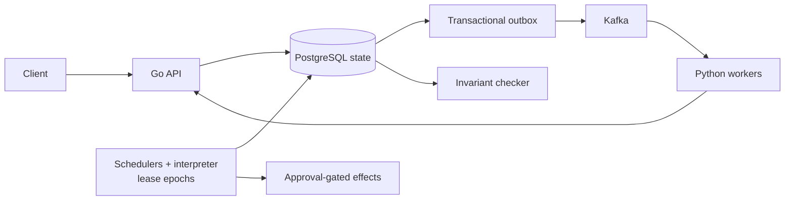

# Distributed Durable Workflow Engine

[](https://github.com/XiaoyunYin/Distributed-Durable-Workflow-Engine/actions/workflows/ci.yml)

A workflow engine that recovers committed work when schedulers lose ownership,
workers restart or messages arrive twice. A Go API and scheduler coordinate
through PostgreSQL, Kafka delivers task notices, and Python workers run
activities. Durable claims, receipts and approval grants let the engine
recover progress and surface uncertain external actions for reconciliation.

## Architecture



The [design document](DESIGN.md) explains committed state and recovery,
the major trade-offs, and how this engine's semantics compare with Temporal,
DBOS, Restate and AWS Step Functions.

## Measured results

- **Kubernetes lifecycle recovery.** On single-host, single-node kind on
  GitHub-hosted runners, the synthetic short- and long-workflow campaign
  retained 161 episode records, with 160 passing and one invalid. The measured
  windows contain **118,038 accepted submissions**, summed from the
  per-episode `accepted` counters. The campaign safety checks recorded
  **zero lost or duplicated accepted submissions and zero stale result
  commits**, including in the retained invalid episode. The exercised faults
  were rollouts, process kills, worker scale-down, and voluntary eviction
  under a PodDisruptionBudget. [Lifecycle report](experiments/portfolio/k8s-recovery/k4-v1/acceptance/results.md#safety)
  · [Episode data](experiments/portfolio/k8s-recovery/k4-v1/acceptance/k4-summary.json).
- **Graceful worker drain.** On the same single-host kind setup, abandoned
  attempts fell from **39 of 58** active at intervention in the baseline
  to **0 of 59** with drain enabled. The totals join 15 valid matched pairs
  to their episode records and sum each arm's abandonment counts and active
  attempts. The short-workflow comparison used five pairs each for worker
  rollout, scale-down, and voluntary eviction.
  [Paired episode data](experiments/portfolio/k8s-recovery/k4-v1/acceptance/k4-summary.json).
- **Lease recovery.** A single-host Docker Desktop/WSL2 process-fault
  study recorded **60 takeovers, 60 useful recoveries, 180 fenced stale-owner
  writes, and zero false takeovers**. The harness had one affected workflow
  per episode across 60 crash or pause episodes, with 10 episodes per
  fault and lease-setting combination. Useful recovery meant committing a
  replacement attempt for the affected work. [Lease study](experiments/m7/dur027/results.json).
- **Scheduler sweep.** At an offered **2 workflows/s**, one scheduler
  completed a median 1.37–1.64 workflows/s across the sequential and
  fan-out/fan-in pure workloads. Two schedulers reached 1.97–1.98
  workflows/s. The single-host Docker Desktop/WSL2 engine harness used four
  fixed worker processes and three runs per configuration, with 24 measured
  workflows per run. The numbers describe this direct engine-path harness.
  [Scheduler sweep](experiments/m7/dur026/results.json).
- **Checkpoint trade-off.** After an in-process panic, every-chunk
  checkpointing took **7.6×** the boundary-only median completion time and
  cut median replay by **99 chunks**. The single-host Docker Desktop/WSL2
  harness ran a 200-chunk activity with one SHA-256 work unit per chunk and
  three panic runs per checkpoint setting.
  [Checkpoint study](experiments/m7/dur028/results.json).
- **Dispatch comparison.** Direct PostgreSQL notification had a **35.6 ms**
  median terminal latency versus **51.4 ms** via Kafka. The ready-to-claim
  comparison was unresolved. The single-host Docker Desktop/WSL2 study used
  one pure activity per workflow and three runs per dispatch configuration,
  with 24 measured workflows per run. [Dispatch comparison](experiments/m7/dur035/results.json).
- **Safeguard ablations.** Within-profile latency and throughput spreads
  ranged from **11.7% to 15.8%**, leaving the cost of the safeguards
  unresolved. The single-host Docker Desktop/WSL2 engine harness ran an
  eight-step pure workflow, with three runs per profile and 24 measured
  workflows per run. Separate negative controls exposed missing history, delayed
  dispatch without the outbox, and stale-owner writes.
  [Safeguard ablations](experiments/m7/dur034/results.json).

The kind studies cover lifecycle changes on one host. The local engine-path
studies use bounded fixtures. These measurements leave deployed system
capacity and independent-host recovery unevaluated.

## Evidence highlights

- **Lease fencing.** In the preserved-process network isolation episode of
  the four-arm AWS single-region study, the original worker's late result was
  rejected as `STALE_ATTEMPT`. The campaign used a controller-started cold
  standby and a shared dependency host. [Network isolation episode](experiments/portfolio/cloud-recovery/dur049-aws-20260923-full-0adbac0/network-isolation.json)
  · [Failure case study](experiments/portfolio/recruiter/failure-case-study.md).
- **Recovery through the deployed path.** A normal run and a worker-kill run
  in the single-host Compose pure-activity pilot reached durable terminal
  state through HTTP, PostgreSQL, the outbox, Kafka and the worker.
  [Pilot and traces](experiments/m8/dur042-pilot/).
- **Approval binding.** A PostgreSQL integration test exercises the API,
  workflow engine and effect service with a synthetic incident. It rejects
  changed resources, arguments or revisions, grant reuse and dispatch before
  approval. [Integration test](internal/incident/production_integration_test.go).
- **Admission control.** In the opt-in load-test namespace, submissions
  that would exceed the configured limit on active workflows or pending
  outbox records receive HTTP `429` with `Retry-After`.
  [Admission guard](internal/state/admission.go) · [API contract test](internal/api/server_test.go).

## Correctness evidence

The [mutation manifest](mutations/manifest.json) declares **1,381 cases** in
this source tree. The committed reports are earlier snapshots. The
[PowerShell report](mutations/results-powershell.json) records 18 passing
cases, including 17 behavioral detections and one configuration tripwire, in
one hosted run. The [Bash report](mutations/results-bash.json) records 58
passing cases against an earlier working-tree overlay. The reports cover
their respective case sets. Current CI checks each shell's manifest coverage
and requires the expected detection with a passing baseline.
[Gate rules](mutations/README.md).

Source inventory for this tree contains **430 Go test functions, 4 Go fuzz
targets and 826 Python test functions**. These are counts of declarations in
tracked sources. They include build-tagged files and exclude generated test
instances such as parametrized cases.

The [claim-to-evidence map](experiments/portfolio/recruiter/claim-evidence.md)
links to the retained backend, platform and incident-agent studies.
[Experiment reproduction notes](experiments/README.md) ·
[Scripted demo](demos/recruiter-demo.gif) ([tape and instructions](demos/README.md)).

## Run locally

Prerequisites: Git, Go with `GOTOOLCHAIN=auto` (module pin Go 1.27.4),
CPython 3.12.7, uv 0.9.5 or newer, Docker Desktop 29.7.2 or newer with
Docker Compose v5, and PowerShell 7 or Windows PowerShell 5.1.

```powershell
pwsh ./scripts/bootstrap.ps1 -StartServices
pwsh ./scripts/local-demo.ps1
```

If `pwsh` is unavailable, use Windows PowerShell, for example:

```powershell
powershell.exe -NoProfile -ExecutionPolicy Bypass -File ./scripts/bootstrap.ps1 -StartServices
```

Bootstrap creates a gitignored `.env`, installs locked dependencies, builds
containers, applies migrations, and checks service health. The demo submits via
the API, executes Python activities through Kafka, and checks the durable result
with the independent invariant checker.

The local stack contains two Go scheduler/API replicas, two Python Kafka worker
processes with two slots each (four total), PostgreSQL 18.6, Kafka 4.3.1,
OpenTelemetry Collector 0.160.0, and Prometheus 3.13.0 LTS. All containers
share one Docker Desktop Linux VM. PostgreSQL uses data checksums and enabled
durability settings.

- Runtime health: <http://localhost:8080/healthz>, <http://localhost:8081/healthz>
- Worker health: <http://localhost:8181/healthz>, <http://localhost:8182/healthz>
- Prometheus: <http://localhost:9090>

The deployed demo scans the `local-runtime` namespace and allows only
`pure.echo/v1` and `pure.add/v1`. Unsupported activities pause instead of
executing. Approval/effect execution is covered by the separate production-path
integration test; the default deployment does not run remediation or paid models.
See the [API reference](api/README.md) for the public endpoint surface.

## Validation

```powershell
# Formatting, lint, types, unit tests, and Go race checks.
pwsh ./scripts/ci.ps1 -WithRace

# Real PostgreSQL/Kafka integration; serializes shared database fixtures.
pwsh ./scripts/ci.ps1 -WithServices -WithRace

# Verify committed fault traces against their durable snapshots, offline.
pwsh ./scripts/m5-archive-check.ps1

# Mutation gate; point this at a disposable migrated database.
$env:DURABLE_MUTATION_DATABASE_URL = "postgresql://..."
pwsh ./scripts/mutation-gate.ps1
```

Service-mode CI temporarily stops runtime/worker services to isolate fixtures
and restores them afterward; run it in an isolated development environment.
These commands make no paid model calls. Add `-WithM5` to service-mode CI only
when intentionally rerunning the live fault campaign.

For clean-source, fresh-volume reproduction and restart checks, use the
bootstrap commands above. Ordinary stop/resume preserves data:

```powershell
docker compose --env-file .env -f deploy/local/compose.yaml down
docker compose --env-file .env -f deploy/local/compose.yaml up -d --wait
```

Adding `--volumes` to `down` permanently deletes local dependency data.

## Operating limits

The single-host Compose and kind deployments share PostgreSQL and Kafka
with the application. The default demo runs pure activities. The API is a
local development surface and is unauthenticated by default.
[Measured boundaries and known limitations](DESIGN.md#known-limitations).
